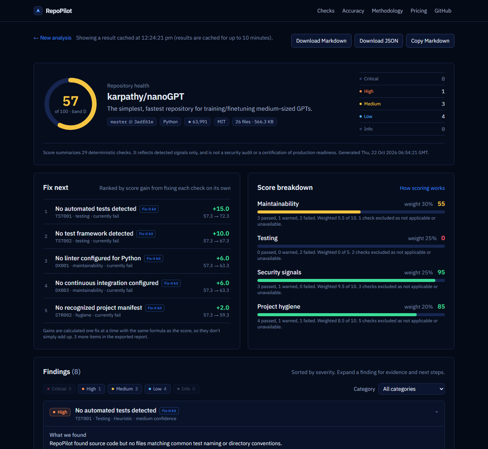
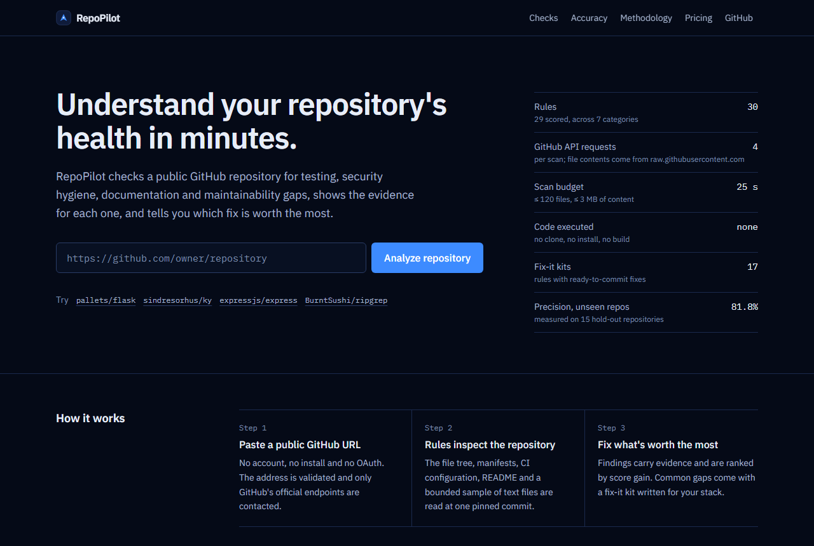
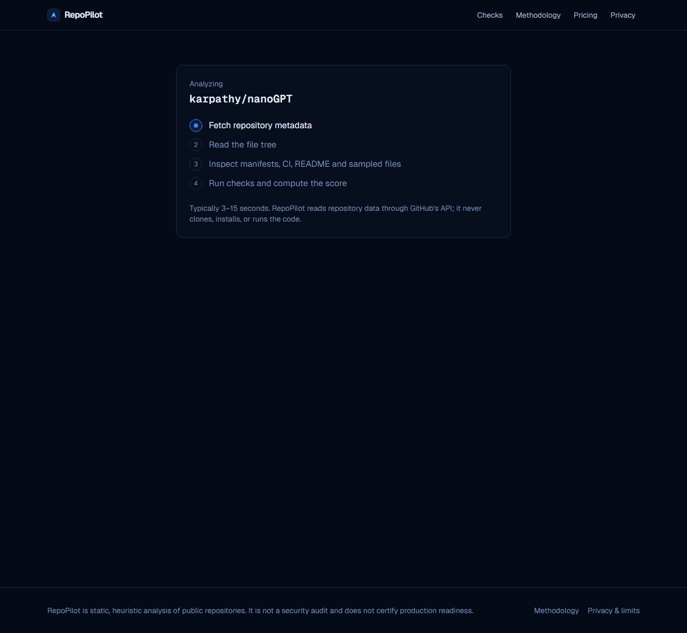

# RepoPilot

**Understand your repository's health in minutes, and know exactly what to fix next.**

[](https://repopilot-rho.vercel.app/analyze/iwan-adler/repopilot)

**Live demo:** https://repopilot-rho.vercel.app — no sign-up; paste any public GitHub repository URL.

RepoPilot analyzes any public GitHub repository with deterministic, documented rules — testing, security signals, documentation, dependency hygiene and maintainability — and produces a transparent 0–100 health score, evidence-backed findings, and Markdown/JSON reports.

It is **not** an AI chatbot: every finding comes from a rule with a stable ID, a rationale and unit tests. The same commit always produces the same report.

> Built for the Galuxium Nexus V2 hackathon by a solo developer on a ₹0 budget.



<table>
  <tr>
    <td></td>
    <td></td>
  </tr>
  <tr>
    <td align="center">Paste any public GitHub URL — no sign-up</td>
    <td align="center">Real progress events streamed from the server</td>
  </tr>
</table>

---

## Features

- **Real scans of real repositories** through GitHub's official REST API — no cloning, no code execution.
- **30 rules** (29 scored + 1 informational) across 7 categories: structure, testing, documentation, developer experience, dependencies, security signals, maintainability. See [`/methodology`](src/app/methodology/page.tsx) in the app.
- **Stack detection**: languages (GitHub linguist), frameworks, test frameworks, manifests, package managers.
- **Credential-pattern detection** with redaction by construction — full secret values never leave the analyzer.
- **GitHub Actions checks**: `pull_request_target` misuse, script injection from untrusted event fields, unpinned third-party actions.
- **Transparent scoring** — not-applicable checks are excluded, not penalized ([docs/SCORING.md](docs/SCORING.md)).
- **"Fix next" plan** — failing checks ranked by the exact score gain from fixing each one, computed with the same formula as the score (e.g. "Add tests: +15.0, 57.3 → 72.3").
- **Fix-it kits** — ready-to-commit files tailored to the detected stack for 17 rules: a CI workflow, `dependabot.yml`, `SECURITY.md`, `CONTRIBUTING.md`, `.gitignore`, test/linter/formatter starters, and `git` commands to untrack committed `.env` or dependency files. Tests prove that applying the generated files makes the targeted checks pass.
- **README badge and link previews** — `/api/badge/{owner}/{repo}` serves an SVG score badge (CDN-cached for hours, so README traffic doesn't trigger scans), and shared report links get a preview image showing the real score and top fix.
- **Live progress** streamed from the server (NDJSON), not a fake animation.
- **Export** reports as Markdown or JSON (schema-validated).
- **Graceful failures**: invalid URLs, private/missing repos, empty repos, GitHub rate limits, timeouts, truncated trees.

## Quick start

Requirements: Node.js 20.9+ (tested with Node 26 locally; CI uses Node 24).

```powershell
git clone https://github.com/iwan-adler/repopilot.git
cd repopilot
npm install
Copy-Item .env.example .env.local   # optional: add a GITHUB_TOKEN
npm run dev
```

Open http://localhost:3000 and paste a public repository URL such as `https://github.com/pallets/flask`.

### Configuration

| Variable                | Required    | Purpose                                                                                                                                                                                                                                                                                                   |
| ----------------------- | ----------- | --------------------------------------------------------------------------------------------------------------------------------------------------------------------------------------------------------------------------------------------------------------------------------------------------------- |
| `GITHUB_TOKEN`          | Recommended | Raises GitHub's limit from 60 to 5,000 requests/hour. Each scan uses 4 API requests (file contents come from `raw.githubusercontent.com`, which does not use the API quota). Use a **fine-grained token with read-only access to public repositories only**. Server-side only; never sent to the browser. |
| `RATE_LIMIT_PER_10_MIN` | No          | Scans per client IP per 10 minutes, per server instance. Default `10`.                                                                                                                                                                                                                                    |

Without a token RepoPilot still works but is limited to roughly 15 scans per hour per server IP.

## Scripts

| Command             | What it does                                                 |
| ------------------- | ------------------------------------------------------------ |
| `npm run dev`       | Development server                                           |
| `npm run build`     | Production build                                             |
| `npm start`         | Serve the production build                                   |
| `npm run lint`      | ESLint                                                       |
| `npm run typecheck` | Generate Next.js route types and run `tsc --noEmit` (strict) |
| `npm test`          | Vitest unit + integration tests (no network required)        |

## API

`GET /api/badge/{owner}/{repo}` returns an SVG badge (always status 200 with a readable message, even on errors, so READMEs never show a broken image).

`POST /api/analyze` with `Content-Type: application/json`:

```json
{ "url": "https://github.com/owner/repo" }
```

- Default: returns `{ "report": Report, "cached": boolean }`.
- With `Accept: application/x-ndjson`: streams `{"type":"progress",...}` lines followed by a final `{"type":"result",...}` or `{"type":"error",...}` line.
- Errors: `{ "error": { "code", "message", "retryAfterSeconds?" } }` with status 400/403/404/413/415/422/429/503/504.

The `Report` shape is defined and validated by Zod in [`src/lib/reports/schema.ts`](src/lib/reports/schema.ts).

## Architecture (summary)

A modular monolith in one Next.js App Router project:

```
src/
  app/                    pages (landing, /analyze/[owner]/[repo], /methodology) and /api/analyze
  components/             UI (dashboard, findings, filters, exports)
  lib/github/             URL parser + bounded GitHub client (2 fixed origins)
  lib/analysis/           stack detection, rules, secrets, workflows, scoring, orchestration
  lib/reports/            Zod schema + Markdown/JSON exporters
  lib/api/                request handler, rate limiting, cache
  lib/validation/         request schemas
tests/                    Vitest suites with a fake in-memory GitHub
docs/                     architecture, scoring, security, business, demo, checklist
```

Details: [docs/ARCHITECTURE.md](docs/ARCHITECTURE.md).

## Testing

```powershell
npm test
```

Tests use fixtures and an in-memory fake of `api.github.com`/`raw.githubusercontent.com`; they never contact GitHub. They cover URL parsing, client error/rate-limit/redirect/size handling, every rule, secret detection and redaction, scoring edge cases, report schema and exports, the API handler (validation, rate limiting, caching, streaming), and budget/deadline enforcement.

## Deployment (Vercel Hobby, free)

1. Push this repository to GitHub.
2. Sign in at https://vercel.com with GitHub and choose **Add New → Project**, then import the repository. The framework preset is detected as Next.js; no build settings need changing.
3. Under **Environment Variables**, add `GITHUB_TOKEN` (fine-grained, public read-only).
4. Deploy. The API route sets `maxDuration = 60` seconds (Hobby allows up to 300 s with Fluid compute, per Vercel's docs as of 2026-08).

See [docs/SUBMISSION_CHECKLIST.md](docs/SUBMISSION_CHECKLIST.md) for verification steps after deploying.

## Limitations

- Static analysis only: no code execution, dependency installation or test runs. Detected tests are **not** executed.
- Content checks read a bounded sample (≤ 120 files, ≤ 3 MB, ≤ 25 s per scan). Very large trees may be truncated; the report says so.
- Credential detection is heuristic — not a security audit. No vulnerability databases are consulted.
- Only the default branch of public repositories is analyzed; Git history is not.
- Organization-wide community health files (CONTRIBUTING, SECURITY) are checked in the owner's `.github` repository; other inherited settings are not.
- Rate limiting and caching are in-memory **per server instance**, not global.
- A high score is not a certification of security, quality or production readiness.

## Documentation

- [Architecture](docs/ARCHITECTURE.md)
- [Scoring algorithm](docs/SCORING.md)
- [Security & privacy](docs/SECURITY.md)
- [Business model](docs/BUSINESS_MODEL.md)
- [Demo script](docs/DEMO_SCRIPT.md)
- [Submission checklist](docs/SUBMISSION_CHECKLIST.md)

## License

[MIT](LICENSE)
